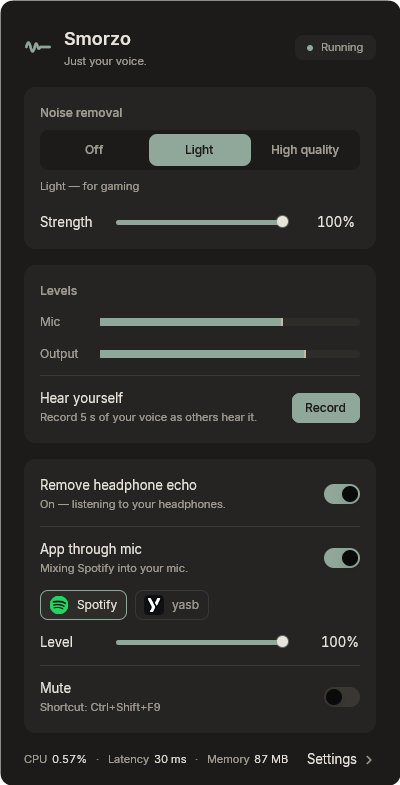
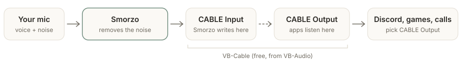
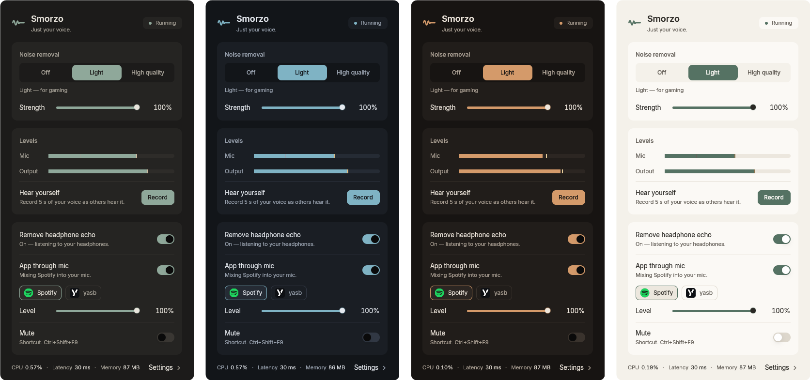

<div align="center">


# Smorzo

**Just your voice.**

Smorzo removes keyboard clicks, fans and room noise from your microphone in real time,
so Discord, games and calls hear only you. Small, CPU-only, quiet while you play.

**[Download for Windows](https://github.com/hamadsh2/Smorzo/releases/latest)** &nbsp;·&nbsp; [Setup](#setup) &nbsp;·&nbsp; [Features](#what-it-does) &nbsp;·&nbsp; [Privacy](#your-audio-stays-yours)

<br>



<sub>Smorzo was called <b>Sotto</b> until v0.5.0. Same app, same settings, <a href="#coming-from-sotto">new name</a>.</sub>

</div>

<br>

## How it works

<picture>
  <source media="(prefers-color-scheme: dark)" srcset="assets/readme/how-it-works-dark.svg">
  
</picture>

Smorzo sits between your microphone and your apps. Your apps use VB-Cable's
**CABLE Output** as their microphone; your headphones and speakers stay exactly as they are.

## Setup

Windows 10 or 11 (64-bit).

1. **Install [VB-Cable](https://vb-audio.com/Cable/)**, a free virtual audio cable:
   download the **"New Package"** zip (`VBCABLE_Driver_Pack46` or newer, not the old
   one), extract all the files, right-click `VBCABLE_Setup_x64.exe` → **Run as
   administrator** → **Install Driver**, then restart Windows.
2. **Install Smorzo** from [Releases](https://github.com/hamadsh2/Smorzo/releases/latest):
   run `Smorzo-<version>-setup.exe`. No admin rights needed.
3. **In Smorzo,** open **Settings** and pick your microphone and **CABLE Input**.
4. **In Discord, your game or call app,** set the microphone to **CABLE Output**.
   Your headphones stay as they are.

<details>
<summary><b>Windows says “Windows protected your PC”?</b></summary>
<br>

The installer isn't code-signed yet, so SmartScreen may warn the first time. Choose
**More info → Run anyway**, after [checking the file's SHA-256](#official-builds) if you like.

</details>

<details>
<summary><b>Uninstalling</b></summary>
<br>

Use *Settings → Apps*. Your settings stay in `%APPDATA%\Smorzo` in case you come back;
delete that folder to remove them too.

</details>

## What it does

| | |
|---|---|
| **Two engines** | *Light* (RNNoise) for gaming, *High quality* (DeepFilterNet) for recording and calls, or *Off* to compare. A strength slider mixes your original voice back in. |
| **Voice chain** | Low-cut filter, voice EQ (Natural, Warm, Clear, Broadcast or your own), noise gate, auto gain and a limiter. Each part can be turned off. |
| **Hear yourself** | Record 5 seconds and play them back once, to hear exactly what others hear. |
| **Headphone echo removal** | For open-back headphones: removes the game or music that leaks from your headphones into your mic. |
| **Music through your mic** | Mix one app's sound into your voice, so friends hear your music with you. [More below](#music-through-your-mic). |
| **Hidden from screen shares** | Your voice isn't sent twice when you share your whole screen in Discord. |
| **Mute from anywhere** | A shortcut (default **Ctrl+Shift+F9**, works in games), the window or the tray. |
| **Stays out of the way** | Closing the window keeps it running in the tray, and it can start with Windows. |

### Four themes

Pick the window's colors in *Settings → Appearance*. **Warm stone** is the default.



## Music through your mic

**App through mic** (off by default) mixes one app's sound into your voice, so your
friends hear your music, a soundboard or a video along with you. The apps playing sound
show up on the main screen with their icons: click one to mix it in, and set its level
right there.

- The level only changes what your friends hear. Your own volume doesn't change.
- **Mute** silences your voice and the app. Turn on *Mute keeps the app playing* to mute
  only your voice. Muting yourself in Discord always silences both.
- Discord can't be picked (your friends would hear themselves), and neither can Teams,
  Zoom or Smorzo itself. Don't pick a browser that has your call open, for the same reason.

For the best result in Discord:

- Use **Voice Activity**, not Push to Talk, so the music isn't cut while you're quiet.
- Set Discord's **Noise Suppression** to None. Krisp removes music as "noise", and Smorzo
  already cleans your voice.
- If your Spotify account is linked to Discord, Discord pauses Spotify after about 30
  seconds of your mic sending sound, which with App through mic is all the time. To keep
  it playing, remove Spotify under *User Settings → Connections* in Discord, or play your
  music in another app.
- **Share a window** instead of your whole screen. A whole-screen share sends the app's
  sound too, so viewers would hear it twice.

## Your audio stays yours

Smorzo carries your voice through exactly **two** devices: the microphone you choose and VB-Cable's **CABLE Input**.

- It **never streams live to your headphones, speakers or DAC**, so your voice is never doubled
  in a screen share or recording. The one exception is **Hear yourself**: when you click Play,
  it plays a 5-second clip of your cleaned voice you just recorded, once, on your default
  playback device, then closes it. The clip stays in memory and is never sent to a virtual
  cable, Voicemeeter or Smorzo's own output.
- **Remove headphone echo** (off by default, for open-back headphones): Smorzo *listens* to
  the headphones you pick, read-only, to know what they're playing and subtract the part
  that leaks into your mic. It never plays anything to them, never changes their settings,
  and keeps nothing it hears. If they're unplugged, echo removal pauses until they're back.
- **App through mic** (off by default): Smorzo *copies* the sound of the one app you pick
  (and the windows it opens), read-only, into its output to CABLE Input. It opens no
  stream on any device, plays nothing anywhere, and keeps nothing. If the app closes,
  mixing pauses until it's back; Smorzo never switches to another app.
- It **never changes Windows sound settings**: not your default devices, volume, formats or enhancements.
- Your **mic is opened in shared mode**, so other apps can still use it.
- **Hide my voice from screen shares** (on by default): Smorzo plays into CABLE Input in
  WASAPI *exclusive* mode. A whole-screen share in Discord records every app's sound,
  which used to include your voice on its way to the cable, so viewers heard you twice.
  Exclusive mode skips the Windows mixer the share listens to, so they hear you once.
  While it's on, no other app can play into CABLE Input. If another app already holds
  the cable exclusively, Smorzo waits for it.
- It creates no virtual devices, and never switches to another device: if one you chose is unplugged, it waits.
- **No telemetry.** The only network use is the update check against this repository's releases.

If CABLE Input ever becomes your default playback device, Smorzo tells you how to fix it,
and leaves the change to you.

## Light on your PC

Measured on an Intel Core i5-14400F, Windows 11, with the window in the tray:

| | Light | High quality |
|---|:---:|:---:|
| CPU (whole machine) | ~0.1 % | ~0.8–0.9 % |
| Time per 10 ms of audio (median / p99) | 0.08 / 0.31 ms | 1.2 / 1.9 ms |
| Memory (whole app) | ~15 MB | ~28 MB |
| GPU | 0 % | 0 % |

The window shows Smorzo's own live CPU, latency and memory at the bottom.

## Coming from Sotto

Smorzo is Sotto's new name (from v0.5.0); the app, the logo and your setup are the same.

- **Updating from inside Sotto works:** Sotto 0.4.0 finds Smorzo as its next update.
- **Your settings move over** from `%APPDATA%\Sotto` on the first start (the old file is
  kept as a backup), and *Start with Windows* stays on if it was on.
- **Installing Smorzo over Sotto** replaces it: same uninstall entry, the old program
  file and shortcuts are removed, and Smorzo goes to `Programs\Smorzo`.
- Old links to `github.com/hamadsh2/Sotto` lead here.

## Official builds

Official builds are published **only** on this repository's
[Releases](https://github.com/hamadsh2/Smorzo/releases) page, built from the tagged
source by [GitHub Actions](.github/workflows/release.yml).

<details>
<summary><b>Verifying a download</b></summary>
<br>

Each release lists the SHA-256 of every file and includes `SHA256SUMS.txt`. In PowerShell:

```powershell
Get-FileHash .\Smorzo-0.5.0-setup.exe -Algorithm SHA256
```

The hash must match the one on the release page.

</details>

<details>
<summary><b>How updates work</b></summary>
<br>

Smorzo checks this repository's releases at start and once a day (you can turn that off)
and tells you when there's a new version. It installs only when you click **Install**,
and only after verifying the download's ed25519 signature against the public key built
into the app.

</details>

<details>
<summary><b>Building from source</b></summary>
<br>

Requires Rust (MSVC toolchain) on Windows.

```powershell
cargo build --release      # target\release\smorzo.exe (the app) and smorzo-cli.exe
cargo test --release
```

`smorzo-cli` runs the same audio engine without a window, for testing and measurements
(`smorzo-cli --help`).

</details>

## License

Smorzo is free software under the [GNU General Public License v3.0 only](LICENSE).

It builds on [RNNoise](https://github.com/xiph/rnnoise) (via
[nnnoiseless](https://github.com/jneem/nnnoiseless)),
[DeepFilterNet](https://github.com/Rikorose/DeepFilterNet),
[cpal](https://github.com/RustAudio/cpal), [GPUI](https://www.gpui.rs/),
[sonora](https://crates.io/crates/sonora) (WebRTC echo cancellation),
the [Inter](https://rsms.me/inter/) font and [Lucide](https://lucide.dev) icons.
All third-party licenses are in the app (*About Smorzo*) and in
[`assets/THIRD_PARTY_LICENSES.txt`](assets/THIRD_PARTY_LICENSES.txt).
VB-Cable is made by VB-Audio and is not part of Smorzo.
